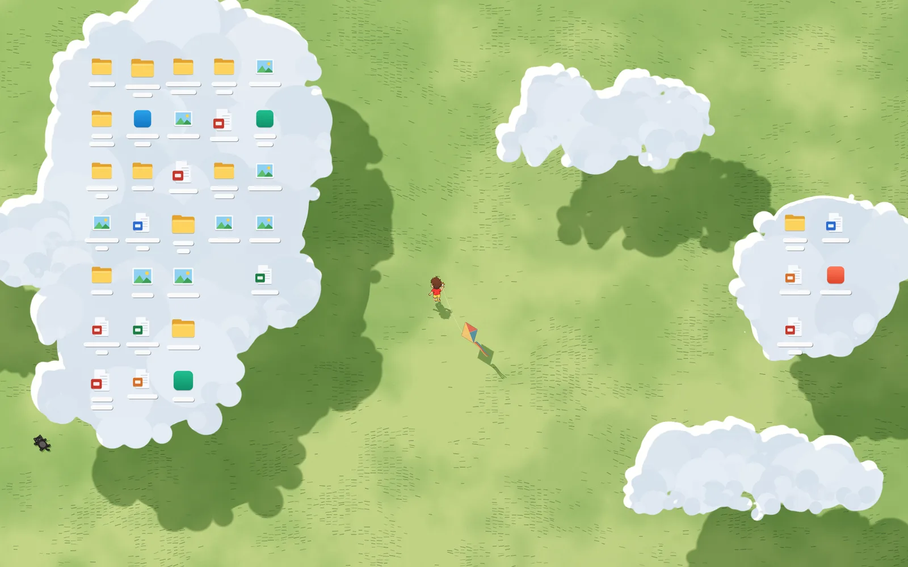
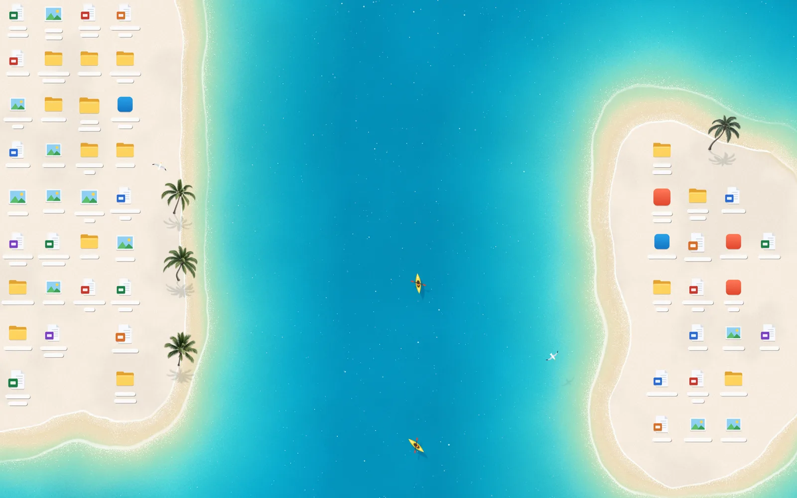
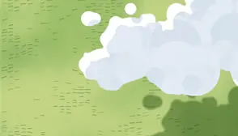
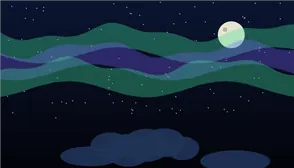

# Deskland+

**Adaptive Windows live wallpaper — your desktop icons become part of the scenery.**

> **Unofficial community fork**
>
> This repository is an unofficial, community-maintained fork of [Deskland](https://github.com/BLEZZ0102/Deskland). It is not released, endorsed by, or affiliated with the upstream project (BLEZZ0102/Deskland / deskland.app). Code and bundled theme assets are GPL-3.0; see [TRADEMARKS.md](TRADEMARKS.md) for trademark terms.

**English** · [简体中文](#deskland-中文说明)

---





## Highlights

- **Adaptive scenery** — scenes read the real positions of your desktop icons and smoothly reshape around them when you move, add, or remove an icon.
- **Four ready themes** — Beach, Meadow, Sky and Aurora, all free and fully parameterized; every setting persists between sessions.
- **Fast and responsive** — WebGL2 rendering runs locally, targeting 30 fps on integrated graphics. Opening Settings takes roughly **0.6 s** in our measurements, with no multi-second blank window.
- **Live theme switching** — the engine is rebuilt inside the same page instead of reloading WebView2, so a theme change takes effect in about **200 ms**.
- **Local and private** — no AI, no account, no API key, no telemetry. Everything is computed on your machine.
- **Independent installation** — its own install directory, settings store (`%LOCALAPPDATA%\DesklandPlus`), startup entry and instance identity, so it can coexist with other Deskland builds.
- **Bilingual UI** — English and Simplified Chinese, switchable in Settings.

### Included themes

| Beach | Meadow | Sky | Aurora |
| --- | --- | --- | --- |
|  |  |  |  |
| Turquoise waves, kayaks, seabirds and coconut palms. | Drifting clouds and shadows, a boy flying a kite and a little black cat. | Cartoon blue sky and puffy clouds, with day, dusk and night. | Flowing aurora bands over a quiet night landscape. |

## Requirements

- Windows 10 or Windows 11, 64-bit.
- Microsoft Edge WebView2 Runtime (already present on most Windows 11 systems).
- To **run a release build**: nothing else.
- To **build from source**: PowerShell, .NET 8 SDK, Node.js LTS and pnpm.

Currently Deskland+ renders on the **primary monitor**.

## Install

Grab the latest Windows installer (or portable ZIP) from the [GitHub Releases page](https://github.com/111hhzz/Deskland/releases/latest).

The installer targets `Programs\Deskland+` under the current user profile and does not require administrator rights. If WebView2 is missing, its bootstrapper needs an internet connection. Uninstalling keeps your settings.

> The installer is unsigned, so Windows SmartScreen may show a warning.

## Build from source

Open PowerShell in the repository root:

```powershell
# 1. Frontend sources -> frontend/dist (Vite)
powershell -ExecutionPolicy Bypass -File frontend\scripts\build.ps1

# 2. Build the host and copy dist -> host/bin/prototype
powershell -ExecutionPolicy Bypass -File host\build.ps1

# 3. Run
.\host\bin\Deskland.exe
```

`tools\build\ci.ps1` performs both steps and then runs the full test suite:

```powershell
powershell -ExecutionPolicy Bypass -File tools\build\ci.ps1
```

Use `-Package` to also build the NSIS installer, or `-SkipTests` to skip testing.

## Using Deskland+

- Double-click the tray icon (or launch the exe again) to open **Settings**.
- Pick a theme and adjust its parameters; changes apply immediately and are saved automatically.
- The tray menu offers pause/resume, restart and exit. When a window is maximized or full-screen, the wallpaper pauses automatically.
- To restore the original Windows wallpaper, choose **Exit** in the tray menu or run:

```powershell
.\host\bin\Deskland.exe --exit
```

### Browser preview (settings UI only)

```powershell
cd frontend
pnpm dev
```

Open <http://localhost:5173/pages/settings.html>. The browser shows sample icons; adapting to real desktop icons requires the Windows host.

## Testing

Run the whole suite (xUnit + Playwright over the WebView2 CDP, plus Vitest for frontend logic):

```powershell
powershell -ExecutionPolicy Bypass -File tools\build\ci.ps1
```

Tests are organised in layers:

- **Unit / logic** — Vitest for token resolution and settings domain logic.
- **End-to-end** — Playwright connects to the running host through the WebView2 CDP ports and drives real pages.
- **Win32 probe** — asserts window structure, Z-order and click-through behaviour.
- **Visual baselines** — frozen-frame pixel comparisons for the wallpaper and settings pages (threshold: 2% differing pixels).

A pre-commit hook runs formatting, a warnings-as-errors build, a dead-code/style check and the test suite before allowing a commit.

## Project layout

| Path | Contents |
| --- | --- |
| `host/` | Windows host (WinForms + WebView2), build script, manifest and icon |
| `frontend/src/engine/` | Rendering engine: `BaseEngine`, `SceneEngine`, per-theme engines, `DeskApp` |
| `frontend/src/scenes/` | Scene implementations (meadow, sky, beach, aurora) |
| `frontend/src/pages/` | Page entries: `engine.html`, `settings.html` |
| `frontend/src/settings/` | Settings page React sources and styles |
| `frontend/public/themes/` | `_products.json` (catalog/entitlements), per-theme `theme.json`, generated CSS, thumbnails |
| `frontend/tokens/` | DTCG design-token sources (single source of truth) |
| `test/Deskland.Tests/` | xUnit + Playwright E2E tests and visual baselines |
| `test/win32-probe/` | Window-structure assertions (standalone C#) |
| `tools/` | Build, packaging, release and local-state scripts |

## Known limitations

- Only the primary monitor is supported.
- Windows Spotlight or a wallpaper slideshow can briefly flash when Windows changes the background image.
- This fork ships no account sign-in, purchase restoration, update service or store API.

## Credits and license

Source code and bundled theme assets are released under [GPL-3.0](LICENSE). Third-party dependencies are listed in [THIRD_PARTY_NOTICES.md](THIRD_PARTY_NOTICES.md).

The Deskland name and icon are not licensed as trademarks; modified distributions should use their own name and icon. See [TRADEMARKS.md](TRADEMARKS.md).

Issues and suggestions are welcome through GitHub Issues. This is an unofficial community fork, so immediate responses are not guaranteed.

---

## Deskland 中文说明

**自适应 Windows 动态壁纸——让你的桌面图标成为风景的一部分。**

> **非官方社区修改版**
>
> 本仓库是 [Deskland](https://github.com/BLEZZ0102/Deskland) 的非官方、社区维护修改版，与上游官方（BLEZZ0102/Deskland / deskland.app）无关联、未获认可或背书。代码与随附主题素材按 GPL-3.0 发布；上游商标条款见 [TRADEMARKS.md](TRADEMARKS.md)。

[English](#deskland) · **简体中文**


### 亮点

- **图标自适应：**场景读取桌面图标的真实位置，在你移动、添加或删除图标时平滑地重新布局。
- **四个完整主题：**沙滩、草地、天空、极光，全部免费且参数完整可调，设置自动保存。
- **轻快流畅：**WebGL2 本地渲染，核显目标 30 fps；实测打开设置窗约 **0.6s**，不再出现数秒白屏。
- **页内热切换：**切换主题时在同一页面内重建引擎，不重载 WebView2，实际生效约 **200ms**。
- **本地私密：**不使用 AI、不需要账号或 API Key，也没有遥测，全部在本地计算。
- **独立安装：**独立的安装目录、设置数据（`%LOCALAPPDATA%\DesklandPlus`）、启动项与实例标识，可与其他 Deskland 版本共存。
- **中英文界面：**设置页内置英文与简体中文切换。

### 包含的主题

| 沙滩 | 草地 | 天空 | 极光 |
| --- | --- | --- | --- |
|  |  |  |  |
| 海浪、皮划艇、海鸟和椰子树。 | 漂浮的云与云影、放风筝的男孩和小黑猫。 | 卡通风蓝天白云，支持白天、傍晚与夜晚。 | 夜空中流动的极光光带。 |

### 系统要求

- Windows 10 / Windows 11，64 位。
- Microsoft Edge WebView2 Runtime（多数 Windows 11 已自带）。
- **运行发行版：**无需其他依赖。
- **从源码构建：**PowerShell、.NET 8 SDK、Node.js LTS 与 pnpm。

目前仅支持**主显示器**。

### 安装

从 [GitHub Releases](https://github.com/111hhzz/Deskland/releases/latest) 下载最新 Windows 安装包（或便携 ZIP）。

安装到当前用户的 `Programs\Deskland+` 目录，无需管理员权限；缺少 WebView2 时会联网安装引导程序；卸载保留用户设置。

> 安装包未签名，Windows SmartScreen 可能给出提示。

### 从源码构建

在仓库根目录打开 PowerShell：

```powershell
# 1. 前端源 -> frontend/dist（Vite）
powershell -ExecutionPolicy Bypass -File frontend\scripts\build.ps1

# 2. 编译宿主并复制 dist -> host/bin/prototype
powershell -ExecutionPolicy Bypass -File host\build.ps1

# 3. 运行
.\host\bin\Deskland.exe
```

`tools\build\ci.ps1` 会依次完成上述两步并跑完整测试：

```powershell
powershell -ExecutionPolicy Bypass -File tools\build\ci.ps1
```

加 `-Package` 同时构建 NSIS 安装包，加 `-SkipTests` 跳过测试。

### 使用

- 双击托盘图标（或再次运行 exe）打开**设置**。
- 选择主题并调整参数，改动立即生效并自动保存。
- 托盘菜单提供暂停/继续、重启与退出；窗口最大化或全屏时自动暂停。
- 退出并恢复系统原壁纸：使用托盘菜单的**退出**，或执行：

```powershell
.\host\bin\Deskland.exe --exit
```

#### 浏览器预览（仅设置界面）

```powershell
cd frontend
pnpm dev
```

打开 <http://localhost:5173/pages/settings.html>。浏览器中使用示例图标；真实桌面图标适配需要 Windows 宿主。

### 测试

一条命令跑完整套件（xUnit + Playwright 经 WebView2 CDP，以及前端 Vitest）：

```powershell
powershell -ExecutionPolicy Bypass -File tools\build\ci.ps1
```

测试分层：

- **单元 / 逻辑：**Vitest 覆盖 token 解析与设置域逻辑。
- **端到端：**Playwright 通过 WebView2 CDP 端口连接运行中的宿主，驱动真实页面。
- **Win32 探针：**断言窗口结构、Z 序与点击穿透行为。
- **视觉基线：**对壁纸与设置页做冻结画面像素比对（阈值：差异像素占比 2%）。

提交前的 pre-commit 钩子会依次执行格式化检查、警告即错误的构建、代码卫生检查与完整测试。

### 目录结构

| 路径 | 内容 |
| --- | --- |
| `host/` | Windows 宿主（WinForms + WebView2）、构建脚本、清单与图标 |
| `frontend/src/engine/` | 渲染引擎：`BaseEngine`、`SceneEngine`、各主题引擎、`DeskApp` |
| `frontend/src/scenes/` | 场景实现（meadow / sky / beach / aurora） |
| `frontend/src/pages/` | 页面入口：`engine.html`、`settings.html` |
| `frontend/src/settings/` | 设置页 React 源码与样式 |
| `frontend/public/themes/` | `_products.json`（清单/授权）、各主题 `theme.json`、生成的 CSS、缩略图 |
| `frontend/tokens/` | DTCG Design Token 源（唯一视觉值来源） |
| `test/Deskland.Tests/` | xUnit + Playwright 端到端测试与视觉基线 |
| `test/win32-probe/` | 窗口结构断言（独立 C#） |
| `tools/` | 构建、打包、发布与本机状态脚本 |

### 已知限制

- 仅支持主显示器。
- 使用 Windows 聚焦或壁纸幻灯片时，系统换图可能造成短暂闪烁。
- 本修改版不包含账号登录、购买恢复、自动更新或商店接口。

### 许可与反馈

项目源码与随附主题素材按 [GPL-3.0](LICENSE) 发布，第三方依赖见 [THIRD_PARTY_NOTICES.md](THIRD_PARTY_NOTICES.md)。

Deskland 名称与图标不作为商标授权授予；修改版应使用自己的名称与图标，详见 [TRADEMARKS.md](TRADEMARKS.md)。

欢迎通过 GitHub Issues 反馈问题和建议。本仓库为非官方社区修改版，不保证即时回复。
